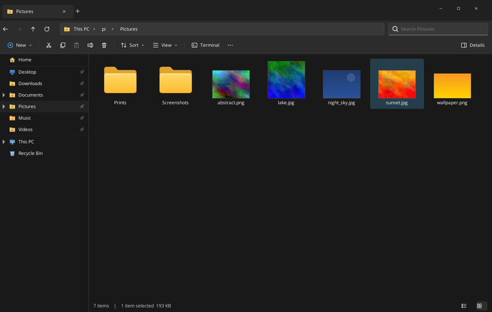
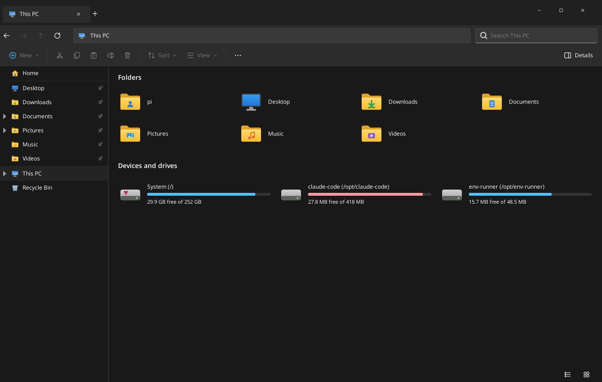
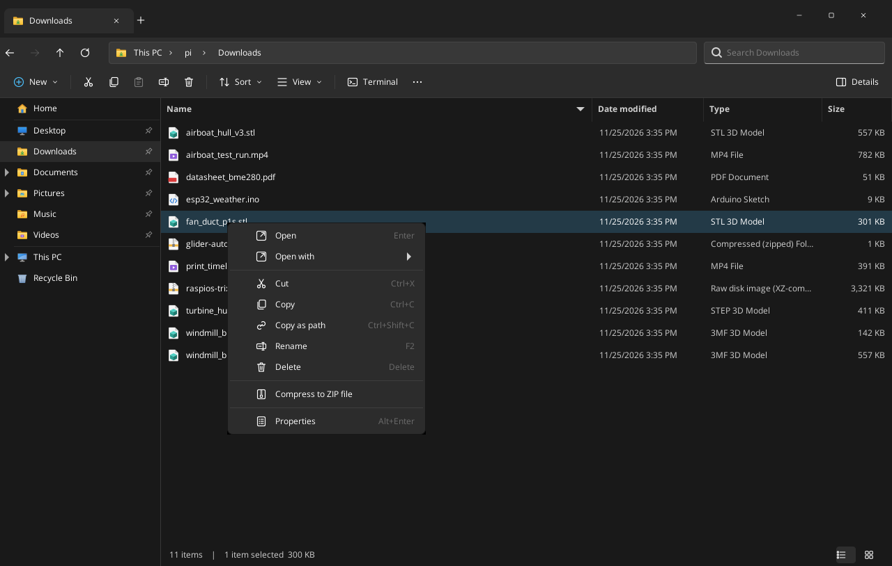
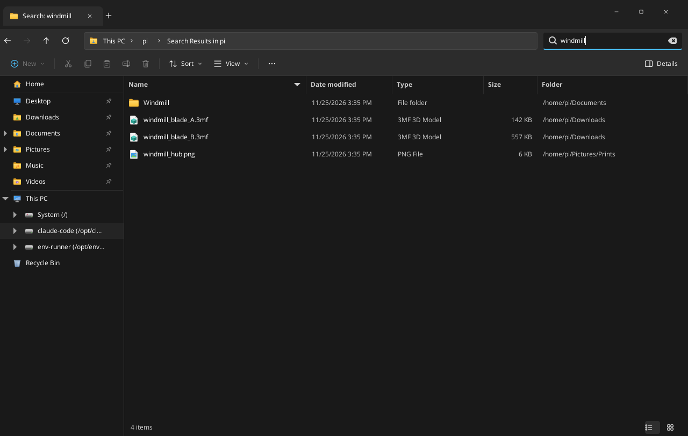
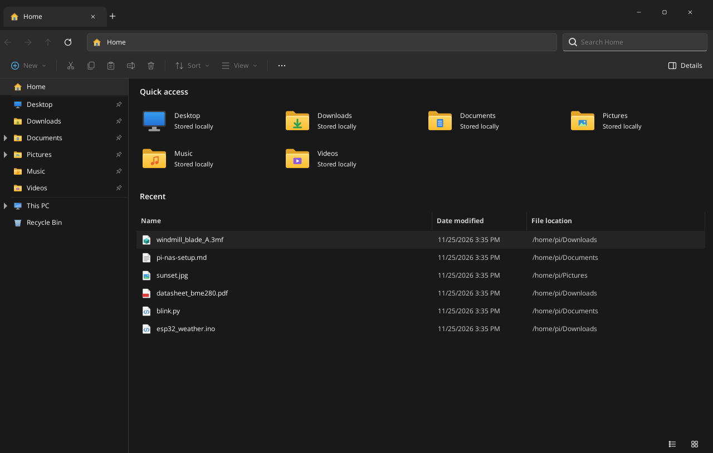

# pi-explorer

A Windows 11 style File Explorer for the Raspberry Pi (built for the Pi 5, works on other Pis running Raspberry Pi OS). Native GTK app, dark theme, opens with **Super+E**, and becomes the default app for opening folders.


## Features

- **Tabs** in the title bar: Ctrl+T, Ctrl+W, Ctrl+Tab, middle-click a folder to open it in a new tab, drag files over a tab to switch to it
- **Address bar** with clickable breadcrumbs. Click a **>** arrow to jump to a subfolder, or click the empty part of the bar to type a path (with folder auto-complete)
- **Search** the current folder and everything inside it as you type. Wildcards like `*.stl` work too
- **Views**: Details, Medium, Large and Extra large icons, with picture and video thumbnails. Ctrl+mouse wheel changes the icon size. Each folder remembers its own view
- **Home** page with Quick access folders and recently opened files
- **This PC** page with your folders plus every drive, its free space bar, and Eject for USB drives
- **Navigation pane** with pinned folders and expandable This PC tree. You can drop files on any folder in it
- **Recycle Bin** with Restore, Restore all and Empty Recycle Bin (uses the normal Linux trash, so it matches the old file manager)
- **File operations**: copy, cut, paste, drag and drop, rename in place (F2), new folder, new text/Python/shell file, delete to Recycle Bin, Shift+Delete to delete permanently
- **Replace or Skip Files** dialog when names clash (Replace, Skip, or Keep both) and a Windows-style progress window with speed and time remaining
- **Compress to ZIP file** and **Extract all** (zip, tar.gz, tar.xz and more)
- **Details pane** (Alt+Shift+P) with a large preview, image dimensions and dates
- **Properties** (Alt+Enter) with size and file/folder counts, a used/free chart for drives, Read-only and Hidden attributes, and a Permissions tab
- **Open with** menu listing your installed apps, **Open in Terminal**, **Copy as path**
- Colored Windows 11 style icons for folders and file types, including 3D printing files (STL, 3MF, STEP, G-code)







## Install

In a terminal on the Pi (as your normal user, not with sudo):

```
git clone https://github.com/wvfouram/pi-explorer.git && bash pi-explorer/install.sh
```

Then press **Super+E**, or open **Accessories > File Explorer** from the menu, or run `pi-explorer`.

## What the installer does

- Installs `python3-gi`, `python3-gi-cairo`, GTK 3, `gvfs`, `ffmpegthumbnailer` (video thumbnails) and the Open Sans font
- Puts the app in `/opt/pi-explorer` and a launcher at `/usr/local/bin/pi-explorer`
- Adds a menu entry and icon
- Makes File Explorer the default app for opening folders (`xdg-mime default pi-explorer.desktop inode/directory`). The old file manager stays installed and still draws your desktop icons
- Adds Super+E to `~/.config/labwc/rc.xml` (or Wayfire / Openbox config), keeping a backup

## Keyboard shortcuts

| Keys | Action |
|---|---|
| Super+E | Open File Explorer |
| Ctrl+T / Ctrl+W | New tab / close tab |
| Ctrl+Tab | Next tab |
| Ctrl+N | New window |
| Alt+Left / Alt+Right / Alt+Up | Back / Forward / Up |
| Backspace | Back |
| Ctrl+L or Alt+D | Type in the address bar |
| Ctrl+F or Ctrl+E | Search |
| F5 | Refresh |
| Ctrl+C / Ctrl+X / Ctrl+V | Copy / Cut / Paste |
| Ctrl+A | Select all |
| F2 | Rename |
| Delete / Shift+Delete | Recycle Bin / delete permanently |
| Ctrl+Shift+N | New folder |
| Ctrl+Shift+C | Copy as path |
| Alt+Enter | Properties |
| Alt+Shift+P | Details pane |
| Ctrl+H | Show hidden files |
| Ctrl+Shift+1 / 2 / 3 / 6 | Extra large / Large / Medium icons / Details |

## Settings

Open **... > Options** to pick where File Explorer opens (Home, This PC or your home folder), show hidden files, show file name extensions, turn thumbnails off, hide recent files, ask before deleting, and clear recent file history. Settings are stored in `~/.config/pi-explorer/settings.json`.

## Uninstall

```
bash pi-explorer/uninstall.sh
```

This removes the app and the Super+E shortcut and makes the Pi's original file manager (PCManFM) the default for folders again.

## License

MIT
